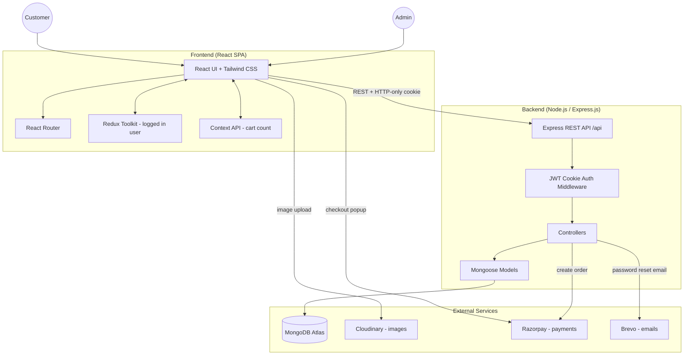

# ⚡ ElectroPlaza - Full Stack E-commerce For Electronics

ElectroPlaza is a full stack MERN e-commerce platform for electronic products. Customers can search and filter products, save a wishlist, review products, and pay online with Razorpay. Admins get a dashboard to manage products, stock, users and orders.

**Live Demo:** (https://e-commerce-frontend-xgf2.onrender.com)

---

## 🏗️ System Architecture

The following diagram illustrates the high-level architecture of ElectroPlaza:



The backend follows an **MVC-style layered structure**: `routes → middleware → controllers → models`, with one controller file per action.

---

## 🌟 Key Features

### 👨‍💻 Customer Experience
- **Responsive Design:** Works on mobile, tablet, and desktop, with smooth page transitions and hover effects.
- **Product Discovery:**
  - Search products by name or category (search runs after you stop typing).
  - Category page with **price range filter**, **sort by price** and **pagination** (done on the server).
  - Home page sliders, category shortcuts and discount badges (e.g. `-27%`).
- **Product Page:** Image gallery with zoom, real **average rating**, stock status ("Only 3 left", "Out of stock") and recommended products.
- **Reviews & Ratings:** Logged-in users can rate (1-5 stars) and review a product; one review per user per product.
- **Wishlist:** Save products and move them to the cart later.
- **Shopping Cart:** Add, update quantity or remove items, with live total.
- **Checkout & Payments:**
  - Delivery address saved in profile and required at checkout.
  - **Razorpay** payment; total is calculated on the server and the payment signature is verified.
  - **My Orders** page with order status and delivery address.
- **Account:**
  - Sign up, login and logout with JWT stored in an HTTP-only cookie.
  - **Forgot / reset password** by email link (valid for 15 minutes).
  - **My Profile:** edit name and photo, change password, save delivery address.

### 🛠️ Administrative Capabilities
- **Dashboard:** Revenue, paid orders, users, products, out-of-stock count and orders by status.
- **Product Management:** Upload, edit and delete products with multiple images, prices and **stock quantity**.
- **Order Management:** View all paid orders with customer and address, and update status (Placed → Shipped → Delivered / Cancelled).
- **User Management:** View all users and change roles (Admin / General).
- All admin APIs are protected on the server, not only hidden in the UI.

---

## 🔒 Security & Performance

- Admin-only routes check the user's role on the server.
- Cart, wishlist, review and order actions only work on the logged-in user's own data.
- Password hash and reset tokens are never sent in API responses; reset tokens are stored hashed.
- Search input is escaped before it is used in a database query.
- Same payment cannot be processed twice, and stock is reduced only after a verified payment.
- Single aggregation query for the category list, database indexes, and lean queries returning only needed fields.
- Gzip compression on API responses.
- Cloudinary images are served resized and in modern formats (WebP/AVIF), and lazy-loaded.
- Admin and order pages are code-split, so shoppers download less JavaScript.

---

## 🚀 Technical Stack

### Frontend
- **React.js 18:** Single Page Application (SPA).
- **React Router v6:** Routing with lazy-loaded pages.
- **Redux Toolkit:** Logged-in user state.
- **Context API:** Cart count shared across components.
- **Tailwind CSS:** Utility-first styling with custom animations.
- **React Icons, React Toastify, Moment.js**

### Backend
- **Node.js & Express.js:** REST API.
- **MongoDB & Mongoose:** Database with schema-based models.
- **JWT + Cookie-Parser:** Token-based authentication in HTTP-only cookies.
- **bcryptjs:** Password hashing.
- **Razorpay SDK:** Online payments.
- **Compression:** Gzip API responses.

### Cloud Services
- **MongoDB Atlas:** Managed database.
- **Cloudinary:** Product and profile image hosting.
- **Razorpay:** Payment gateway (test mode supported).
- **Brevo:** Transactional emails for password reset (HTTP API).
- **Render:** Hosting for the backend and frontend.

---

## ⚙️ Project Structure

```text
e-commerce/
├── backend/                # Express application source code
│   ├── config/             # Database connection
│   ├── controller/         # One file per action
│   │   ├── user/           # Auth, profile, address, cart
│   │   ├── product/        # Products, search, filter
│   │   ├── order/          # Razorpay order, payment verify, orders
│   │   ├── review/         # Reviews and ratings
│   │   ├── wishlist/       # Wishlist
│   │   └── dashboard/      # Admin dashboard summary
│   ├── helpers/            # Admin permission check, send email
│   ├── middleware/         # JWT authentication
│   ├── models/             # User, Product, Cart, Order, Review, Wishlist
│   └── routes/             # API endpoint definitions
├── frontend/               # React application source code
│   ├── src/
│   │   ├── common/         # API endpoints (SummaryApi), roles, order status
│   │   ├── components/     # Reusable UI components
│   │   ├── context/        # Context API
│   │   ├── helpers/        # Uploads, currency, discount, image optimize, Razorpay loader
│   │   ├── pages/          # Route-based page components
│   │   ├── routes/         # React Router configuration
│   │   └── store/          # Redux store and slices
```

---

## 🔗 API Endpoints

All routes are prefixed with `/api`. 🔐 = login required, 👑 = admin only.

| Area | Endpoints |
|---|---|
| **Auth** | `POST /signup`, `POST /signin`, `GET /userLogout`, `GET /user-details` 🔐, `POST /forgot-password`, `POST /reset-password` |
| **Profile** | `POST /update-profile` 🔐, `POST /change-password` 🔐, `POST /update-address` 🔐 |
| **Users** | `GET /all-user` 👑, `POST /update-user` 👑 |
| **Products** | `GET /get-product`, `GET /get-categoryProduct`, `POST /category-product`, `POST /product-details`, `GET /search?q=`, `POST /filter-product` |
| **Product Admin** | `POST /upload-product` 👑, `POST /update-product` 👑, `POST /delete-product` 👑 |
| **Cart** | `POST /addtocart` 🔐, `GET /countAddToCartProduct` 🔐, `GET /view-card-product` 🔐, `POST /update-cart-product` 🔐, `POST /delete-cart-product` 🔐 |
| **Orders** | `POST /create-order` 🔐, `POST /verify-payment` 🔐, `GET /order-list` 🔐, `GET /all-order` 👑, `POST /update-order-status` 👑 |
| **Reviews** | `POST /add-review` 🔐, `POST /product-review` |
| **Wishlist** | `POST /add-wishlist` 🔐, `GET /view-wishlist` 🔐, `POST /delete-wishlist` 🔐 |
| **Dashboard** | `GET /dashboard` 👑 |

---

## 🛠️ Installation & Setup

### Prerequisites
- Node.js installed
- MongoDB Atlas account
- Cloudinary account (with an **unsigned upload preset** named `mern_product`)
- Razorpay account (test keys) - for payments
- Brevo account with a verified sender email - for password reset emails

### Step 1: Backend Setup
1. Navigate to the backend folder: `cd backend`
2. Install dependencies: `npm install`
3. Create a `.env` file and add:
   ```env
   PORT=7070
   MONGODB_URI=your_mongodb_connection_string
   TOKEN_SECRET_KEY=any_long_random_secret
   FRONTEND_URL=http://localhost:3000
   NODE_ENV=development

   # payments (Razorpay test keys)
   RAZORPAY_KEY_ID=rzp_test_xxxxxxxx
   RAZORPAY_KEY_SECRET=your_razorpay_secret

   # password reset emails (Brevo)
   BREVO_API_KEY=your_brevo_api_key
   EMAIL_FROM=your_verified_sender@gmail.com
   ```
4. Start the server: `npm run dev`

### Step 2: Frontend Setup
1. Navigate to the frontend folder: `cd frontend`
2. Install dependencies: `npm install`
3. Create a `.env` file and add:
   ```env
   REACT_APP_BACKEND_URL=http://localhost:7070
   REACT_APP_CLOUD_NAME_CLOUDINARY=your_cloudinary_cloud_name
   ```
4. Start the application: `npm start`

### Step 3: Create an Admin
Sign up on the site, then in MongoDB Atlas change that user's `role` from `GENERAL` to `ADMIN`. After that, the admin can change other users' roles from the Admin Panel.

### Test Payment
With Razorpay test keys, no real money is charged. Use the UPI ID `success@razorpay` or a test card from the Razorpay docs.

---

## ☁️ Deployment Notes (Render)

- **Backend:** set all backend `.env` values in the Render environment, with `NODE_ENV=production` (needed for cross-site login cookies) and `FRONTEND_URL` set to the exact frontend URL (no trailing slash).
- **Frontend (static site):** set `REACT_APP_BACKEND_URL` to the backend URL, and add a rewrite rule `/*` → `/index.html` so refreshing a page (e.g. `/product/:id`) does not show "Not Found".
- Render's free plan blocks SMTP ports, so emails are sent through Brevo's HTTP API instead of Gmail SMTP.
- MongoDB Atlas free clusters pause after long inactivity; resume the cluster from the Atlas dashboard if the site stops loading products.

---

## 👤 Author
**Subhodip Shee**
- GitHub: [@SubhodipShee](https://github.com/SubhodipShee)

---

## 🤝 Contributing
Contributions are welcome! Please feel free to submit a Pull Request. For major changes, please open an issue first to discuss what you would like to change.
